# ws_sql2 AI-DLC Execution Plan

## Detailed Analysis Summary

### Transformation Scope
- **Transformation type**: Architectural addition in a brownfield platform.
- **Primary change**: Add a new DuckDB-backed ESP service and static HPCC extension.
- **Compatibility boundary**: Existing `ws_sql` remains unchanged and available.
- **Affected areas**: ESP service contracts, CMake/vcpkg, Dali/security, HPCC readers, DuckDB integration, JSON serialization, packaging, observability, and tests.

### Change Impact Assessment
- **User-facing changes**: Yes. Adds SQL execution and metadata APIs with explicit authorization and result contracts.
- **Structural changes**: Yes. Adds a new service, plugin, extension boundary, and query-engine runtime.
- **Data model changes**: Yes. Introduces HPCC-to-DuckDB type and nested-value mapping, but no persistent schema migration.
- **API changes**: Yes. Adds unreleased baseline `wssql2` ECM methods: ExecuteSQL, ListFiles, DescribeFile, and ExplainScan.
- **NFR impact**: High. Security, resource isolation, cancellation, pushdown semantics, observability, PBT, and resiliency guidance apply.

### Component Relationships
- **Primary component**: `esp/services/ws_sql2`.
- **Contract component**: `esp/scm/ws_sql2.ecm` and generated schema targets.
- **Build components**: `esp/services/CMakeLists.txt`, CMake plugin wiring, vcpkg manifests, packaging/build-set configuration.
- **Shared components**: Dali/security, `common/thorhelper`, `common/fileview2`, `dafilesrv`, `ccdactivity`, field-filter/key utilities, ESP exception/JSON/metrics infrastructure.
- **Unchanged dependent component**: `esp/services/ws_sql` remains independent.

### Risk Assessment
- **Risk level**: Critical.
- **Rollback complexity**: Moderate for repository changes because the new service is independently enabled; deployment rollback is end-user owned.
- **Testing complexity**: Complex due to binary readers, KEY semantics, nested types, authorization, concurrency, limits, and residual-filter equivalence.
- **Primary risks**: Security boundary bypass, semantic drift in pushdown, ESP process exhaustion, reader lifetime/thread-safety errors, incorrect nested serialization, and packaging omissions.

## Workflow Visualization

```mermaid
flowchart TD
    Start([User Request]) --> WD[Workspace Detection]
    WD --> RE[Reverse Engineering]
    RE --> RA[Requirements Analysis]
    RA --> US[User Stories]
    US --> WP[Workflow Planning]
    WP --> AD[Application Design]
    AD --> UG[Units Generation]
    UG --> FD[Functional Design]
    FD --> NR[NFR Requirements]
    NR --> ND[NFR Design]
    ND --> ID[Infrastructure Design]
    ID --> CG[Code Generation]
    CG --> BT[Build and Test]
    BT --> End([Complete])
    style Start fill:#CE93D8,stroke:#6A1B9A,stroke-width:3px,color:#000
    style End fill:#CE93D8,stroke:#6A1B9A,stroke-width:3px,color:#000
    style WD fill:#4CAF50,stroke:#1B5E20,stroke-width:3px,color:#fff
    style RE fill:#4CAF50,stroke:#1B5E20,stroke-width:3px,color:#fff
    style RA fill:#4CAF50,stroke:#1B5E20,stroke-width:3px,color:#fff
    style US fill:#4CAF50,stroke:#1B5E20,stroke-width:3px,color:#fff
    style WP fill:#FFA726,stroke:#E65100,stroke-width:3px,stroke-dasharray:5 5,color:#000
    style AD fill:#FFA726,stroke:#E65100,stroke-width:3px,stroke-dasharray:5 5,color:#000
    style UG fill:#FFA726,stroke:#E65100,stroke-width:3px,stroke-dasharray:5 5,color:#000
    style FD fill:#FFA726,stroke:#E65100,stroke-width:3px,stroke-dasharray:5 5,color:#000
    style NR fill:#FFA726,stroke:#E65100,stroke-width:3px,stroke-dasharray:5 5,color:#000
    style ND fill:#FFA726,stroke:#E65100,stroke-width:3px,stroke-dasharray:5 5,color:#000
    style ID fill:#FFA726,stroke:#E65100,stroke-width:3px,stroke-dasharray:5 5,color:#000
    style CG fill:#4CAF50,stroke:#1B5E20,stroke-width:3px,color:#fff
    style BT fill:#4CAF50,stroke:#1B5E20,stroke-width:3px,color:#fff
    linkStyle default stroke:#333,stroke-width:2px
```

### Text Fallback
1. Completed: Workspace Detection, Reverse Engineering, Requirements Analysis, User Stories.
2. Current: Workflow Planning.
3. Execute next: Application Design, Units Generation.
4. Execute per unit: Functional Design, NFR Requirements, NFR Design, Infrastructure Design, Code Generation.
5. Final mandatory stage: Build and Test.
6. Operations remains a placeholder; deployment decisions owned by the end user.

## Recommended Stage Decisions

### INCEPTION PHASE
- [x] Workspace Detection - **COMPLETED**.
- [x] Reverse Engineering - **COMPLETED** using the plan-grounded brownfield baseline.
- [x] Requirements Analysis - **COMPLETED and approved**.
- [x] User Stories - **COMPLETED and approved**.
- [ ] Workflow Planning - **IN PROGRESS**.
- [ ] Application Design - **EXECUTE**. New service, query-engine boundary, extension, reader adapters, and cross-component contracts need high-level ownership and interfaces.
- [ ] Units Generation - **EXECUTE**. The plan spans multiple modules and has explicit dependency ordering and a KEY/pushdown first-unit decision.

### CONSTRUCTION PHASE
- [ ] Functional Design - **EXECUTE per unit**. Required for reader semantics, type mapping, pushdown equivalence, nested values, and testable properties.
- [ ] NFR Requirements - **EXECUTE per unit**. Required for security, PBT framework selection, resource isolation, performance, and observability.
- [ ] NFR Design - **EXECUTE per unit**. Required to turn blocking security, PBT, and resiliency rules into implementable controls.
- [ ] Infrastructure Design - **EXECUTE per unit**. Required for CMake/vcpkg, ECM generation, service configuration, Linux packaging, GitHub Actions compatibility, and end-user deployment boundaries.
- [ ] Code Generation - **EXECUTE**. Required for implementation plans and code/tests for every approved unit.
- [ ] Build and Test - **EXECUTE**. Required for focused targets, integration fixtures, PBT, performance checks, and Linux packaging validation.

### OPERATIONS PHASE
- [ ] Operations - **PLACEHOLDER**. End-user deployment, rollback, topology, resiliency testing, and incident response are outside this repository workflow; implementation artifacts must document the ownership boundary.

## Unit and Package Change Sequence

The following sequence is proposed for Units Generation; exact unit artifacts will be produced and approved in that stage.

1. **Build and contract foundation**: WSSQL2_SERVICE, DuckDB vcpkg/CMake wiring, ECM contract, plugin/service skeleton, and static extension registration.
2. **Metadata and type foundation**: Dali binding, authorization context, shared HPCC-to-DuckDB mapper, nested-value model, and metadata methods.
3. **KEY and pushdown core**: KEY reader adapter, filter translation, key monitors, projection handling, residual semantics, and ExplainScan. This is the approved first implementation priority.
4. **FLAT and result execution**: FLAT/compressed/superfile readers, vector production, JSON serialization, limits, cancellation, and ExecuteSQL orchestration.
5. **Packaging, observability, and validation**: service configuration, Linux packaging, metrics/traces/logging, fixtures, ESP tests, PBT, performance/regression checks, and documentation.
6. **Offline scan descriptor (FR-12, added 2026-10-14)**: metadata-source seam, `layout`/`parts`/`options` serialization, the Dali-free `hpcc_scan(layout, parts, options)` overload, SQL schema generation, and the `GetScanDescriptor` ESP method.

### Dependency Strategy
- Sequential foundation: Unit 1 blocks Units 2 through 6.
- Shared metadata dependency: Unit 2 blocks reader and pushdown units.
- Parallel opportunity: Unit 3 and the non-reader portions of Unit 4 may develop in parallel after Unit 2, but integration requires both.
- Offline descriptor: Unit 6 starts after Units 3 and 4 stabilize the reader seams and must pass descriptor round-trip equivalence before Unit 5 release validation.
- Final integration: Unit 5 depends on all runtime units, including Unit 6, and the approved service contract.
- Rollback: Keep `WSSQL2_SERVICE` independently disableable and preserve `ws_sql` unchanged throughout.

## Quality and Extension Gates

### Security Baseline
Disabled by the approved Unit 2 unbounded metadata/schema decision. Application-level authentication, DFS authorization, redaction, safe errors, and secret suppression remain required; cloud deployment controls outside this repository remain end-user owned.

### Property-Based Testing
Disabled by the approved Unit 1 NFR decision. Use example-based and regression tests for lifecycle, contract, mapping, filtering, serialization, and boundary behavior; do not add a PBT framework unless the scope is reopened.

### Resiliency Baseline
Enabled as directional guidance. The repository must provide cancellation, limits, observability, explicit failure reporting, and operational handoff documentation. Deployment topology, rollback, resiliency testing, and incident response remain end-user owned per approved requirements.

### Established-Implementation Reference Gate
For every non-trivial construction slice, Code Generation must first inspect the nearest established HPCC implementation before adding new behavior. The applicable reference set includes `ccdactivity`/Roxie, Thor disk/index-read paths, dafilesrv access paths, and `common/fileview2`.

Each unit's implementation notes must record:

- the reference implementation consulted;
- the ownership, metadata/layout translation, part/copy selection, authorization, filter, projection, error, and cancellation semantics reused;
- any intentional deviation and its reason;
- the focused validation that demonstrates the deviation does not change required semantics.

Do not mark a unit's Code Generation complete while an applicable reference comparison or deviation rationale is missing.

### Unreleased Contract Versioning Gate

`ws_sql2` has not had its first release. Until an explicit project decision records that its public contract has shipped:

- keep the ESDL service and default client versions at baseline `1.0`;
- do not add `min_ver` or `depr_ver` attributes to pre-release fields or methods;
- do not increment the service version for pre-release contract additions or changes.

This project-status gate overrides generic ESDL version-increment guidance while the service remains unreleased.

## Success Criteria
- New ws_sql2 service is independently buildable and does not change ws_sql behavior.
- API, authorization, type mapping, readers, pushdown, serialization, limits, and diagnostics satisfy approved requirements and stories.
- Security, PBT, and resiliency compliance is recorded at each applicable stage.
- Linux primary-triplet build, packaging, focused tests, integration fixtures, PBT, and performance/regression checks pass.
- Documentation clearly distinguishes local ESP analytics from distributed Thor/Roxie execution.

## Workflow Plan Checklist
- [x] Load reverse-engineering, requirements, and user-story artifacts.
- [x] Assess transformation scope, impact, relationships, and risk.
- [x] Determine conditional stage decisions.
- [x] Define brownfield package sequence and dependency strategy.
- [x] Generate and validate workflow visualization with text fallback.
- [x] Create this execution plan.
- [x] Obtain explicit approval before entering Application Design.
